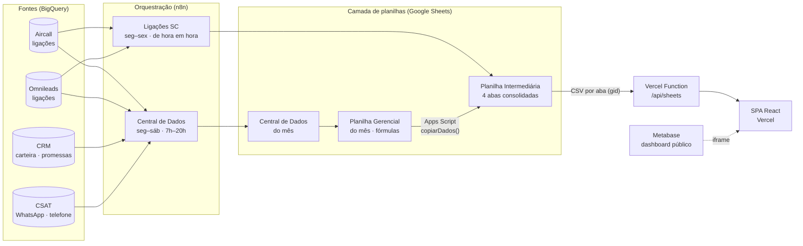

# Dashboard Gerencial · Serviço ao Cliente

Dashboard operacional que mostra, em tempo quase real, os resultados do time de **Serviço ao Cliente (SC)** de uma plataforma digital de renegociação de dívidas que atua como correspondente bancário: depósitos, promessas de pagamento, localização de clientes, baixas, produtividade dos operadores e volume de ligações.

O projeto substituiu um painel em Retool e um pipeline manual em Google Colab por uma **stack própria, automatizada e de custo zero de infraestrutura**: React no front, uma Vercel Function como API e uma camada de dados orquestrada com **n8n + BigQuery + Google Apps Script**.

> ⚠️ Projeto interno. Este repositório é uma versão para portfólio: IDs de planilhas, credenciais, URLs internas, nomes de pessoas e dados de clientes foram removidos ou trocados por exemplos.

<!-- Coloque aqui um GIF ou print do dashboard (com dados fictícios) -->
<!--  -->

---

## Sumário

- [Problema](#problema)
- [Arquitetura](#arquitetura)
- [Stack](#stack)
- [Backend e pipeline de dados](#backend-e-pipeline-de-dados)
  - [1. n8n · Central de Dados](#1-n8n--central-de-dados)
  - [2. n8n · Ligações (de hora em hora)](#2-n8n--ligações-de-hora-em-hora)
  - [3. Apps Script · Sincronização das planilhas](#3-apps-script--sincronização-das-planilhas)
  - [4. Vercel Function · `/api/sheets`](#4-vercel-function--apisheets)
- [Frontend](#frontend)
- [Páginas](#páginas)
- [Regras de negócio](#regras-de-negócio)
- [Operação: virada de mês](#operação-virada-de-mês)
- [Desafios e soluções](#desafios-e-soluções)
- [Como rodar localmente](#como-rodar-localmente)
- [Próximos passos](#próximos-passos)

---

## Problema

A gestão do SC acompanhava os números do time em planilhas grandes, alimentadas por um notebook Colab rodado à mão e por `IMPORTRANGE`s instáveis. Havia também um dashboard em Retool que a conta da empresa não permitia evoluir. Os problemas eram:

- dados de ligações atualizados manualmente, às vezes uma vez por dia;
- planilhas quebrando por limite de `IMPORTRANGE` e por diferença de localidade (datas e números lidos errados);
- nenhuma visão por operador, por hora ou comparação com a média da equipe;
- dependência de ferramentas pagas e sem controle de versão.

**Objetivo:** um dashboard único, rápido, versionado no Git, que se atualiza sozinho e que a gestão consegue usar sem abrir nenhuma planilha.

---

## Arquitetura



**Por que planilhas no meio do caminho?** A gestão já mantinha a lógica de negócio (metas, times, carteiras) em fórmulas da planilha gerencial. Manter o Sheets como camada de "modelo" permitiu entregar rápido, sem reescrever regras que mudam todo mês, e deixou o dashboard como uma camada de leitura fina e barata.

---

## Stack

| Camada | Tecnologia |
|---|---|
| Frontend | Vite · React · TypeScript · Recharts · TanStack Table · Radix UI (Tabs) · React Router |
| API | Vercel Serverless Function (Node) |
| Orquestração | n8n (self-hosted) |
| Data warehouse | Google BigQuery (SQL) |
| Camada de modelo | Google Sheets + Google Apps Script |
| BI complementar | Metabase (dashboard público via iframe) |
| Deploy | Vercel (deploy automático a cada push) |

---

## Backend e pipeline de dados

### 1. n8n · Central de Dados

Substitui o notebook Colab que alimentava a planilha "Central de Dados" do mês. Roda de **segunda a sábado, das 7h às 20h**, e atualiza seis abas:

| Aba | Conteúdo | Volume típico |
|---|---|---|
| B3 | Carteira de clientes + data da última chamada efetiva | ~16 mil linhas |
| B4 | Promessas de pagamento (com promessa anterior) | ~750 |
| B19 | Chamadas do mês de vendas (Aircall + Omnileads) | ~2,5 mil |
| B20 / B21 | CSAT do mês anterior / atual | ~700 / ~120 |
| B23 | Mapa cliente × conversa (incremental: só anexa IDs novos) | — |

**Desenho (v3):**

```
Schedule / manual
  → Config (datas do mês de vendas + ID da planilha)
  → Monta queries (1 item por aba)
  → Execute Workflow (chama o próprio workflow, 1 sub-execução por aba)
  → Resumo

Sub-execução por aba:
  BigQuery → Clear (A2:última coluna, mantém cabeçalho) → Monta valores
  → IF tem linhas → Append → Retorno
```

Cada aba roda numa **sub-execução isolada** (padrão "workflow chama a si mesmo"). A versão anterior fazia tudo em um único loop e travava por acúmulo de memória; separando por aba, a execução completa leva **~1,5–2 min** e uma falha em uma aba não derruba as outras.

Todas as datas saem do SQL em **ISO (`AAAA-MM-DD`)** e todos os valores numéricos saem como número, não texto. Isso torna o resultado independente da localidade da planilha (veja [Desafios](#desafios-e-soluções)).

### 2. n8n · Ligações (de hora em hora)

Alimenta a aba `Resumo Ligacoes`, usada pelas páginas **Ligações** e **Produtividade**.

- **Agendamento:** `0 * * * 1-5`, de hora em hora, de segunda a sexta
- **Pipeline:** `Schedule → Clear Sheet → Wait → BigQuery → Code → Loop (lotes de 85) → Wait → Append Row`

A query une as duas plataformas de telefonia em um formato único e filtra **sempre o mês corrente** (sem data fixa, então não precisa de manutenção na virada):

```sql
WITH chamadas AS (
  -- Aircall
  SELECT
    FORMAT_DATETIME("%m/%d/%Y %H:%M:%S",
      DATETIME(TIMESTAMP(ca.started_at), "America/Sao_Paulo")) AS call_datetime_sp,
    ca.duration   AS call_duration,
    ca.user_email AS agent
  FROM telefonia.call_activities ca
  WHERE ca.country = 'br'
    AND DATETIME(TIMESTAMP(ca.started_at), "America/Sao_Paulo")
        >= DATETIME_TRUNC(CURRENT_DATETIME("America/Sao_Paulo"), MONTH)
    AND DATETIME(TIMESTAMP(ca.started_at), "America/Sao_Paulo")
        <  DATETIME_ADD(DATETIME_TRUNC(CURRENT_DATETIME("America/Sao_Paulo"), MONTH), INTERVAL 1 MONTH)
    AND ca.user_email IN UNNEST(@agentes_sc)

  UNION ALL

  -- Omnileads (filtrado pelo grupo do time)
  SELECT
    FORMAT_DATETIME("%m/%d/%Y %H:%M:%S",
      DATETIME(TIMESTAMP(ch.time), "America/Sao_Paulo")),
    IF(ch.duracion_llamada = -1, 0, ch.duracion_llamada),
    au.email
  FROM omnileads.llamadalog ch
  LEFT JOIN omnileads.agenteprofile ap ON ap.id = ch.agente_id
  LEFT JOIN omnileads.user          au ON au.id = ap.user_id
  LEFT JOIN omnileads.grupo         g  ON g.id  = ap.grupo_id
  WHERE ch.numero_marcado IS NOT NULL
    AND g.nombre = 'Servico ao Cliente'
    AND DATETIME(TIMESTAMP(ch.time), "America/Sao_Paulo")
        >= DATETIME_TRUNC(CURRENT_DATETIME("America/Sao_Paulo"), MONTH)
    -- ... mesmo limite superior e filtro de eventos de discagem
)
SELECT DISTINCT agent, call_datetime_sp, call_duration
FROM chamadas
WHERE agent IS NOT NULL
ORDER BY call_datetime_sp
```

O **Code node** agrega as ligações brutas por `data | operador | hora` e calcula tentativas e efetivas, reduzindo milhares de linhas para algumas centenas antes de gravar:

```javascript
const DURACAO_EFETIVA_SEG = 120; // ligação efetiva = 2 min ou mais
const agg = {};

for (const { json } of $input.all()) {
  const { agent, call_datetime_sp: dt } = json;
  const duracao = Number(json.call_duration) || 0;
  if (!agent || !dt) continue;

  const m = dt.match(/(\d+)\/(\d+)\/(\d+) (\d+):/);
  if (!m) continue;
  const [, mm, dd, yyyy, hh] = m;

  const key = `${dd}/${mm}/${yyyy}|${agent}|${hh}h`;
  agg[key] ??= { tentativas: 0, efetivas: 0 };
  agg[key].tentativas++;
  if (duracao >= DURACAO_EFETIVA_SEG) agg[key].efetivas++;
}

return Object.entries(agg).map(([key, v]) => {
  const [data, agent, hora] = key.split('|');
  return { json: { data, agent, hora, ...v } };
});
```

### 3. Apps Script · Sincronização das planilhas

Substituiu os `IMPORTRANGE`. Um gatilho de tempo copia três abas da planilha gerencial do mês para a planilha intermediária, que é a única fonte lida pelo dashboard:

```javascript
const ORIGEM_ID = 'ID_DA_PLANILHA_GERENCIAL_DO_MES';
const ABAS = ['Resumo Depósitos', 'Resumo Executivo', 'Resumo Baixas'];

function copiarDados() {
  const destinoSS = SpreadsheetApp.getActiveSpreadsheet();
  const origemSS  = SpreadsheetApp.openById(ORIGEM_ID);
  const norm = s => s.trim().toLowerCase();

  for (const nome of ABAS) {
    const origem  = origemSS.getSheetByName(nome);
    const destino = destinoSS.getSheets().find(s => norm(s.getName()) === norm(nome));
    if (!origem || !destino) continue;

    const dados = origem.getDataRange().getValues();
    if (!dados.length) continue;

    destino.clearContents();
    destino.getRange(1, 1, dados.length, dados[0].length).setValues(dados);
  }
}
```

### 4. Vercel Function · `/api/sheets`

Uma função serverless faz o papel de backend do dashboard: busca uma aba da planilha intermediária como CSV e devolve ao front **sem cache**, contornando CORS e o cache agressivo do export do Google.

```javascript
// api/sheets.js
export default async function handler(req, res) {
  const { id, gid } = req.query;
  const url = `https://docs.google.com/spreadsheets/d/${id}/export?format=csv&gid=${gid}`;

  const response = await fetch(url, {
    headers: { 'User-Agent': 'Mozilla/5.0', 'Cache-Control': 'no-cache' },
  });
  const csv = await response.text();

  res.setHeader('Cache-Control', 'no-store, no-cache, must-revalidate');
  res.status(200).send(csv);
}
```

| Aba da planilha intermediária | Usada em |
|---|---|
| Resumo Depósitos | Visão Geral, Localizados, Promessas, Depósitos, Operadores |
| Resumo Executivo | Resumo Executivo |
| Resumo Baixas | Resumo Baixas |
| Resumo Ligacoes | Ligações, Produtividade |

---

## Frontend

### Estrutura

```
├── api/
│   └── sheets.js            # Vercel Function (proxy CSV)
├── src/
│   ├── hooks/
│   │   └── useSheetData.ts  # busca, parse e cache compartilhado
│   ├── pages/               # 1 componente por rota
│   ├── components/          # cards de KPI, tabelas, gráficos, modais, header/filtros
│   └── main.tsx
└── vite.config.ts
```

### `useSheetData`: cache em nível de módulo

Várias páginas e componentes leem as mesmas abas. Para não disparar uma requisição por componente, o hook guarda o estado **fora do React**, em variáveis de módulo, com um conjunto de listeners (padrão de store simples, sem biblioteca):

```typescript
let _data: SheetData | null = null;
let _loading = true;
let _error: string | null = null;
let _fetchPromise: Promise<void> | null = null;   // deduplica requisições em voo
const _listeners = new Set<() => void>();

export function useSheetData() {
  // ... assina _listeners, dispara loadData() uma única vez
  return {
    data: _data, loading: _loading, error: _error,
    refresh: () => { clearSheetCache(); _fetchPromise = null; loadData(); },
  };
}
```

- Primeira montagem dispara a carga; as demais reaproveitam a mesma `Promise`.
- O botão **Atualizar** no header limpa o cache e recarrega tudo, e todos os componentes inscritos re-renderizam juntos.

### Filtros globais

Carteira, Segmento e Operador ficam no header e aparecem **só nas páginas em que fazem sentido** (Resumo Executivo e Ligações). Assim o usuário não vê filtros que não têm efeito na página atual.

### Identidade visual

Tema escuro alinhado à marca: fundo `#201d49`, superfícies `#302d71`, destaque `#8062de`, tipografia Montserrat.

---

## Páginas

| Rota | Página | O que mostra |
|---|---|---|
| `/` | **Visão Geral** | KPIs principais e funil (localizados → promessas → depósitos), com alternância **Dívida / Cliente** |
| `/resumo/:carteira/localizados` | Localizados | Detalhe de localização por carteira |
| `/resumo/:carteira/promessas` | Promessas | Promessas vigentes por carteira |
| `/resumo/:carteira/depositos` | Depósitos | Depósitos por carteira |
| `/operadores` | **Operadores** | Resultado individual, com filtro por time |
| `/resumo-executivo` | **Resumo Executivo** | Visão por time com grupos Depósito · % Depósito · Localização · Baixas |
| `/resumo-baixas` | Resumo Baixas | Baixas realizadas e previstas |
| `/ligacoes` | **Ligações** | Tentativas e efetivas por operador; clique no nome abre um modal com comparação **vs. equipe** (gráficos e rankings) |
| `/produtividade` | **Produtividade** | Mapa de calor **dias × horas** de tentativas e efetivas por operador |
| `/atendimento-sc` | Atendimento | Dashboard Metabase embutido via iframe, com modo escuro (`invert + hue-rotate`) e recarga |

---

## Regras de negócio

- **Ligação efetiva:** duração **≥ 120 segundos**.
- **Tentativa:** toda chamada discada pelo operador (Aircall + Omnileads unificados).
- **Promessas na Visão Geral:** só as **vigentes** (no modo Cliente, por quantidade; no modo Dívida, pelo valor). Um card separado mostra o total de promessas em todos os status.
- **Funil:** usa sempre a mesma unidade do modo selecionado (não mistura clientes com valor de dívida).
- **Totais do Resumo Executivo:** lidos diretamente das linhas de total da planilha, em vez de somados no front. Somar no front duplicava subtotais e inflava os números.

---

## Operação: virada de mês

A planilha gerencial é recriada todo mês. O processo foi reduzido a poucos passos:

1. Criar a planilha do novo mês e dar acesso de editor à service account.
2. **Central de Dados (n8n):** atualizar no nó `Config` as datas do mês de vendas e o ID da planilha.
3. **Apps Script:** trocar `ORIGEM_ID` e rodar `copiarDados()` uma vez.
4. **Ligações (n8n):** nada a fazer, a query usa `DATETIME_TRUNC` no mês corrente.
5. Clicar em **Atualizar** no dashboard.

---

## Desafios e soluções

| Desafio | Solução |
|---|---|
| `IMPORTRANGE` falhando e travando a planilha | Troca por Apps Script com gatilho de tempo, copiando valores (não fórmulas) |
| Ligações atualizadas à mão no Colab | Pipeline n8n + BigQuery de hora em hora, sem intervenção |
| Duas plataformas de telefonia com esquemas diferentes | `UNION ALL` normalizando data (fuso de São Paulo), duração e e-mail do operador |
| Planilha nova em localidade Brasil lia `11-09-2026` como 11/set e `4168.7` como `41687` | Todas as datas em ISO e números como número, independente da localidade |
| Workflow único do n8n travando por memória | Uma sub-execução por aba (workflow chama a si mesmo) |
| `REGEXP_REPLACE(x, r'R\$', '')` quebrando dentro do n8n | `REPLACE(x, CODE_POINTS_TO_STRING([82, 36]), '')`, sem `\` + `$` no SQL |
| Sem permissão para editar credenciais no n8n | Uso apenas dos nós nativos (BigQuery, Google Sheets) com a credencial já existente |
| Muitas requisições repetidas ao abrir o dashboard | Cache em nível de módulo com deduplicação de `Promise` |
| Export CSV do Google em cache | Vercel Function com headers `no-store` |
| Totais do executivo inflados | Leitura das linhas de total da própria planilha |

---

## Como rodar localmente

```bash
git clone https://github.com/<seu-usuario>/dash-sc.git
cd dash-sc
npm install
npm i -g vercel        # para rodar a função /api localmente
vercel dev             # front + /api/sheets em http://localhost:3000
```

Configure o ID da planilha e os `gid`s das abas (por exemplo, num `.env.local`):

```bash
VITE_SHEET_ID=seu_id_de_planilha
VITE_GID_DEPOSITOS=0
VITE_GID_EXECUTIVO=000000000
VITE_GID_BAIXAS=000000000
VITE_GID_LIGACOES=000000000
```

A planilha precisa estar compartilhada como "qualquer pessoa com o link pode ver" para o export CSV funcionar. Para a demo pública, use uma planilha com **dados fictícios**.

---

## Próximos passos

- **Gravação atômica no n8n de ligações:** hoje a aba é limpa e regravada em lotes, então por alguns segundos o dashboard pode ler dados parciais. Plano: gravar numa aba de staging e só então trocar.
- **Endurecer `/api/sheets`:** whitelist de IDs e `gid`s e repasse do status HTTP real do Google.
- **Lista de operadores dinâmica** no Aircall, no lugar da lista fixa na query.
- **Histórico mensal** de ligações, hoje restrito ao mês corrente.
- **Dados do Metabase direto no React**, substituindo o iframe por componentes no tema da marca.

---

## Autor

**João**, engenheiro de automação e dados. n8n · BigQuery · PostgreSQL · React · Apps Script · agentes de IA.

<!-- LinkedIn / e-mail de contato -->
